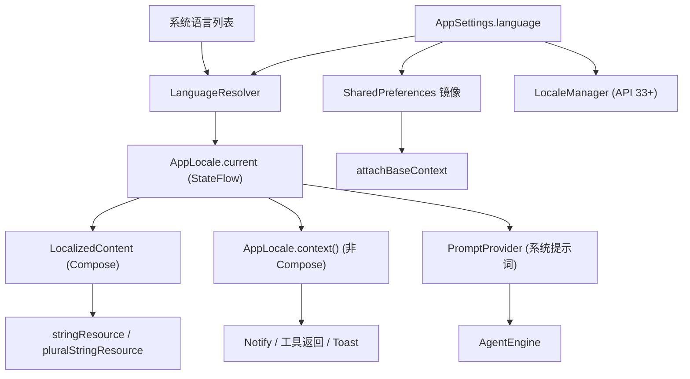

# 多语言支持

Feature Name: 2026-10-29-multi-language-support
Updated: 2026-10-29

## Description

为 DevCodex 提供六种语言（zh-CN、zh-TW、zh-HK、en、ja、ko）。用户在设置页选择语言，默认跟随系统，切换后界面即时刷新，Activity 不重建。文案、通知、工具返回、默认系统提示词全部按 Effective Locale 输出。项目保持 minSdk 26、targetSdk 28，不引入 appcompat。

## Architecture



核心思路：

1. 语言解析集中在 `LanguageResolver`，输出唯一的 Effective Locale。
2. `AppLocale` 持有当前 Locale 的 `StateFlow`，Compose 与非 Compose 代码都从它取值。
3. Compose 层用 `createConfigurationContext` 生成带目标 Locale 的 Context，通过 `LocalContext` 与 `LocalConfiguration` 下发，`stringResource` 自动取到新语言，实现不重建 Activity 的即时切换。
4. DataStore 读取是异步的，所以语言选项同步镜像到一个 SharedPreferences 小文件，`attachBaseContext` 与 `Application.onCreate` 同步读取，冷启动首帧即为正确语言。

## Components and Interfaces

### AppLanguage（枚举）

`SYSTEM, ZH_CN, ZH_TW, ZH_HK, EN, JA, KO`，每项带 `tag`（如 zh-TW）与本语言显示名（简体中文、繁體中文（台灣）、繁體中文（香港）、English、日本語、한국어）。

### LanguageResolver

`resolve(setting: AppLanguage, systemLocales: List<Locale>): AppLanguage`，纯函数，便于单元测试。规则：

- 选项不是 SYSTEM 时直接返回该选项。
- SYSTEM 时遍历系统语言列表，返回首个可映射的 Supported Locale。
- 映射：zh 且 script 为 Hant，或 country 为 TW，映射 zh-TW；country 为 HK、MO，映射 zh-HK；其余 zh 映射 zh-CN；en、ja、ko 直接映射。
- 列表中没有可映射项时返回 EN。

### AppLocale（object）

- `current: StateFlow<Locale>`，`@Volatile` 快照供后台线程读取。
- `init(ctx)`：读 SharedPreferences 镜像并解析。
- `set(ctx, language)`：写镜像、更新 StateFlow、API 33+ 调用 `LocaleManager.setApplicationLocales`。
- `context(base: Context): Context`：返回带当前 Locale 的 Context，供通知、Toast、工具使用。
- `string(resId, vararg args)`：非 Compose 场景的便捷取串。

### LocalizedContent（Composable）

在 `MainActivity.setContent` 最外层包裹，收集 `AppLocale.current`，用 `remember(locale)` 构造本地化 Context 与 Configuration，通过 `CompositionLocalProvider` 提供 `LocalContext`、`LocalConfiguration`、`LocalLayoutDirection`。其下所有页面无需改动取串方式。

### 系统级同步

- `res/xml/locales_config.xml` 声明六种语言，清单 `<application>` 增加 `android:localeConfig`。
- Android 13 及以上：`MainActivity.onResume` 读取 `LocaleManager.applicationLocales`，与应用内选项不一致时以系统值为准并回写 Language Setting。
- Android 12 及以下：仅应用内选项生效；无障碍服务名称等系统读取的文案跟随系统语言，这是平台限制，记入文档。
- `MainActivity` 的 `configChanges` 保持不含 locale，系统语言变化会重建 Activity，SYSTEM 模式随之重新解析。

### 资源组织

- `res/values/strings.xml` 作为 en 基线（同时承担回退）。
- 其余五套：`values-zh-rCN`、`values-zh-rTW`、`values-zh-rHK`、`values-ja`、`values-ko`。
- key 命名：`<模块>_<用途>`，如 `settings_language_title`、`chat_send`、`tool_err_file_not_found`。
- 含变量使用 `%1$s`、`%2$d`；数量相关使用 `plurals`（中日韩仅 other）。
- 默认系统提示词放 `res/raw/default_system_prompt.txt` 及对应的 `raw-zh-rCN`、`raw-zh-rTW`、`raw-zh-rHK`、`raw-ja`、`raw-ko`，由 `PromptProvider` 经本地化 Context 读取。
- `docs/i18n-glossary.md` 记录统一术语表（Agent、工作区、沙盒、提供商、插件、技能、工具、会话、思考），zh-TW 与 zh-HK 各自一栏。
- `app/build.gradle.kts` 增加 `androidResources { localeFilters += listOf("en","zh-rCN","zh-rTW","zh-rHK","ja","ko") }`，减小三方库带入的无用语言资源。

### 文案抽取范围

按现状约 1300 处硬编码中文，分布：界面层约 230 处字面量与 28 处字符串模板（SettingsScreen 占一半）；工具层 ExtraTools、BuiltinTools、AdvancedFsTools、MediaTools 约 260 处；AgentEngine、AppViewModel、ShellAccess、TermuxRuntime、PRootUbuntu、McpClient、ModelRegistry、ProviderPresets 等约 300 处。处理规则：

- 面向用户的文字全部外置。
- 日志（DebugLog、CrashHandler）保持原文与固定 Locale.US，不外置。
- 工具返回保留 ERROR 前缀、工具名、参数名、命令输出原文，只翻译说明部分。
- 模型协议字段（JSON key、工具 schema 的 name）保持不变；工具 schema 的 description 属于给模型看的说明，随系统提示词语言切换。
- 抽取先用脚本生成 `文件:行号:字面量` 清单，再逐文件替换，每个文件替换后立即回读确认语法。

### 本地化格式

`SimpleDateFormat`、`DateTimeFormatter`、`getDisplayName` 面向界面的调用统一传 `AppLocale.current.value`；日志与文件名时间戳继续固定 Locale.US。

### 内置技能与插件

内置条目的名称与描述在 assets 对应 JSON 或 md 中增加 `i18n` 映射。展示时，若条目内容与内置种子一致（未被用户编辑），按 Effective Locale 取译文；已编辑的条目显示原文。实现前先读取 `assets/plugins`、`assets/skills` 的现有结构确认字段。

## Data Models

```kotlin
// AppSettings 新增字段，缺省值保证旧数据兼容（ignoreUnknownKeys 已开启）
val language: String = "SYSTEM"
```

SharedPreferences 镜像：文件 `locale_prefs`，键 `language`，值与 `AppSettings.language` 一致。`SettingsRepo` 保存设置时同步写镜像，保证两处一致。

## Correctness Properties

1. `resolve` 的输出始终属于六种 Supported Locale 之一。
2. 对同一输入，`resolve` 的结果固定，与调用时机无关。
3. 六套 strings.xml 的 key 集合相同，同 key 的格式参数个数与类型相同。
4. 语言切换只改变展示，不修改任何已持久化的会话、记忆、技能、插件、提供商内容。
5. 切换语言时 ViewModel、Agent 任务、后台终端保持原实例，不被重建。
6. 用户输入、模型输出、文件内容、Custom System Prompt 保持原文。
7. zh-TW 与 zh-HK 为独立资源，各自使用本地通行词汇。

## Error Handling

- 镜像文件读取失败或值非法：按 SYSTEM 处理并写日志。
- `LocaleManager` 调用抛异常：捕获并写日志，应用内语言仍生效。
- 某 key 在目标语言缺失：Android 资源机制回退到 values（en）；同时由单元测试与 lint 在构建期拦截。
- 提示词 raw 资源读取失败：回退 en 版本并写日志。
- 格式化参数个数不符：由单元测试在构建期发现，运行期以 `runCatching` 兜底返回未格式化文案，避免崩溃。

## Test Strategy

单元测试（需在 `app/build.gradle.kts` 增加 `testImplementation` JUnit，当前依赖里没有）：

- `LanguageResolverTest`：覆盖需求 2 全部情形，含 zh-Hant-TW、zh-Hant-HK、zh-MO、zh-Hans-CN、系统列表首项不支持但次项支持、无支持语言。
- `StringsParityTest`：用标准 XML 解析读取六套 strings.xml，校验 key 集合一致、`%n$s` 与 `%n$d` 占位符一致、plurals 的 item 完整。
- `PromptParityTest`：六份系统提示词均存在，且条目数相同。
- 术语一致性检查：词汇表中每个术语在对应语言的资源里出现。

构建与 lint：

- `lint` 中把 `MissingTranslation`、`StringFormatMatches`、`StringFormatInvalid` 设为 error。注意当前 `abortOnError = false`，lint 不会让构建失败，所以构建期拦截主要靠上述单元测试，并在 CI 的 workflow 中增加测试步骤。
- 云端构建产出 debug APK 后，由你在真机逐语言检查设置页、聊天页、统计页、终端页和扩展页；我无法在本地运行界面，不会声称已验证显示效果。

## 实施顺序（一次交付内的内部顺序）

1. 基础设施：AppLanguage、LanguageResolver、AppLocale、LocalizedContent、`attachBaseContext`、SettingsRepo 镜像、locales_config、localeFilters、测试依赖与单元测试。
2. 设置页语言选项与词汇表。
3. 生成硬编码清单，按模块外置文案并产出六套资源：先界面层，再工具层，再其余。
4. 系统提示词六语言版本与 PromptProvider。
5. 内置技能与插件的 i18n 展示。
6. 本地化格式、README 与版本说明更新（版本 0.4.0 / 86 已设置）。
7. 提交、推送、触发云端构建，交付 APK 与真机验证清单。

## 风险

- 单次改动面大：涉及数十个文件和约 1300 处文案，回归风险高，所以每个文件替换后回读，并按模块分多次提交，便于回滚。
- 译文没有母语者复核，措辞可能不够自然；术语表和单元测试只能保证一致性。
- minSdk 26 与 targetSdk 28 保持不变，Android 13 以下的系统级语言设置不可用。
- `createConfigurationContext` 方案需要真机确认 Compose 文本、Toast、对话框在切换后全部刷新。

## References

[^1]: (Filename) - requirements.md 同目录需求文档
[^2]: (Filename#L16-L39) - app/src/main/kotlin/ai/devcodex/agent/MainActivity.kt
[^3]: (Filename#L13-L60) - app/src/main/kotlin/ai/devcodex/agent/data/SettingsRepo.kt
[^4]: (Filename#L488-L501) - app/src/main/kotlin/ai/devcodex/agent/agent/AgentEngine.kt
